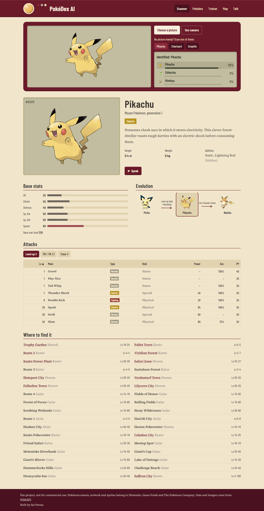
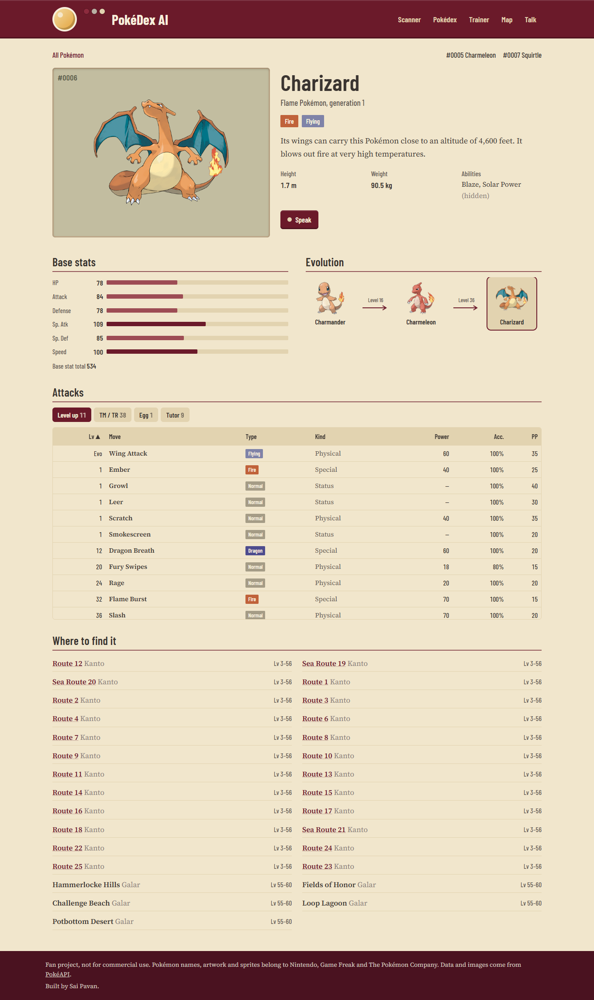
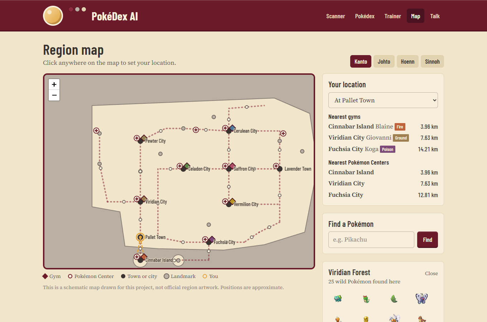
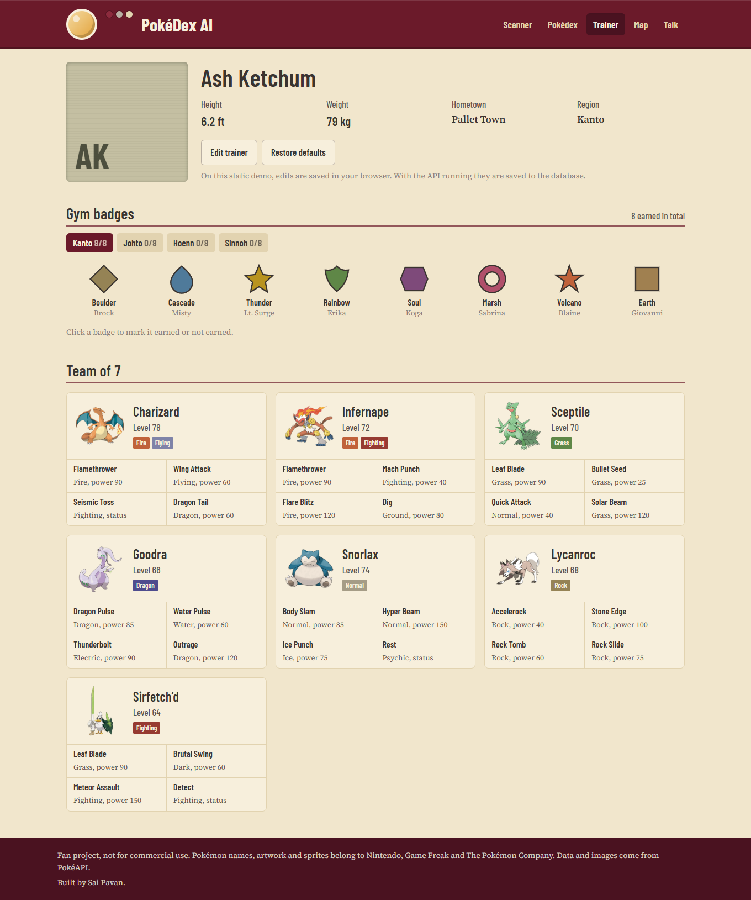
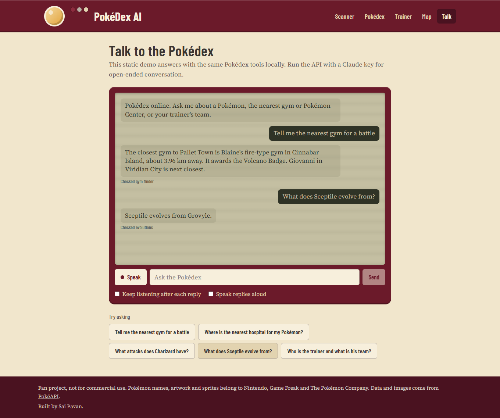
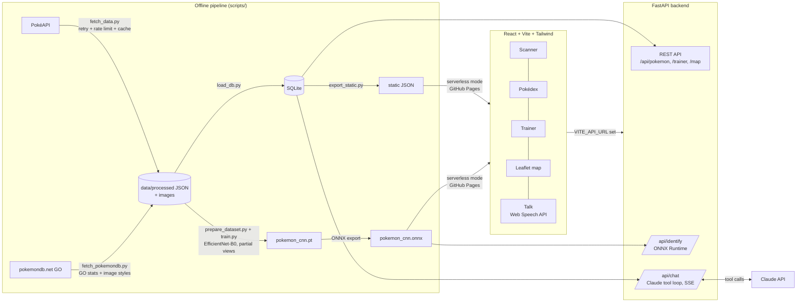
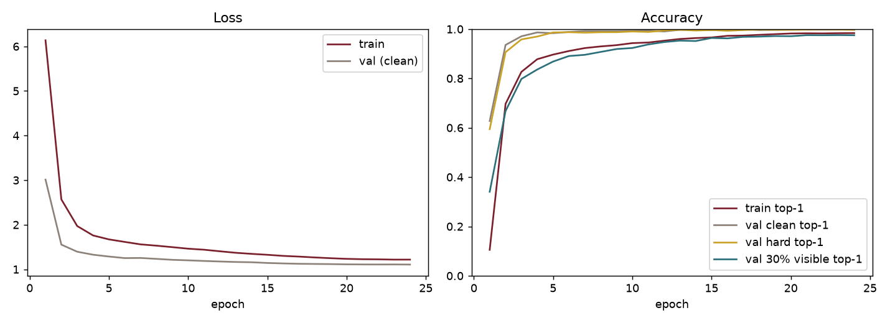

# PokéDex AI

A working Pokédex: point it at a picture and a neural network identifies the Pokémon, then shows its
stats, attacks, evolution chain and where to find it. You can also talk to it by voice. It answers
from its own database through Claude tool calls.

**Live demo:** https://saipavanavsp.github.io/pokedex-ai/
**Author:** Sai Pavan



## Highlights

- **Image identification with a CNN.** MobileNetV2 fine-tuned with transfer learning on 1,025
  Pokémon (Gen 1 to 9). It reaches **97.5% top-1 / 99.2% top-3** accuracy on held-out images. The model is exported to
  ONNX and runs **in the browser** on the live site, or on the server via `POST /api/identify`.
- **Complete data pipeline.** About 6,000 PokéAPI calls with retries, rate limiting and a disk
  cache, then SQLite through SQLAlchemy. That covers 1,025 Pokémon, 797 moves, 79,120 learnset
  rows, 540 evolution chains and 16,447 wild encounters.
- **Voice assistant built on Claude tool use.** Seven tools (`get_pokemon_info`, `get_attacks`,
  `get_evolutions`, `find_nearest_gym`, `find_nearest_pokemon_center`, `get_trainer_profile`,
  `identify_last_uploaded_image`) ground every answer in the database. Replies stream over
  server-sent events and are spoken with the Web Speech API. Continuous listening is supported.
- **Interactive maps.** Leaflet over original schematic maps of Kanto, Johto, Hoenn and Sinnoh
  with 32 gyms, 52 Pokémon Centers and encounter locations. It finds the nearest gym or Center from
  any point you click.
- **Editable trainer profile.** Profile, badges and a team of seven are stored in the database and
  editable from the UI.
- **Production touches.** 25 automated tests (pytest and Vitest), GitHub Actions CI, Docker and
  docker-compose, a Render blueprint, a Vercel config, a mobile layout, and loading and error states
  throughout.

## Screenshots

| Pokédex entry | Region map |
|---|---|
|  |  |
| **Trainer** | **Talk** |
|  |  |

Mobile: [scanner](docs/screenshots/scanner-mobile.png), [trainer](docs/screenshots/trainer-mobile.png),
[talk](docs/screenshots/talk-mobile.png). Browse: [all fire types](docs/screenshots/browse.png).

## Architecture



The frontend runs in two modes:

- **With the API** (`VITE_API_URL` set): data, identification, trainer edits and Claude chat all
  go through FastAPI.
- **Serverless** (the live demo): the same pages read exported JSON. The CNN runs in the browser
  with ONNX Runtime Web. The chat runs the same seven tools locally through an intent router, so
  answers still come from the data. Trainer edits are kept in the browser.

## Model results

Training: about 45,000 images. PokéAPI sprites from every game generation, including animated frames;
Pokémon GO, HOME, Scarlet/Violet, BDSP and Sword/Shield sprites plus large artwork and alternate
forms scraped from [pokemondb.net](https://pokemondb.net/go/pokedex); and 6,000 public-domain
real-world images of Gen 1 Pokémon. Half of the training samples are **partial views** that keep only
15–90% of the Pokémon's pixels. The rest get random backgrounds, crops, rotation, colour jitter, blur,
low resolution and JPEG damage. EfficientNet-B0 (ImageNet weights) at 224 px, AdamW with a one-cycle
schedule and label smoothing. One sprite style per Pokémon is held out for testing.

| Test set (via the deployed ONNX pipeline) | Top-1 | Top-3 |
|---|---|---|
| Unseen sprite style, 1,025 images | **99.8%** | 100.0% |
| Same images cropped, low-res, blurred, JPEG | **99.9%** | 100.0% |
| **Only 30% of the Pokémon visible**, 3,075 crops of unseen styles | **97.6%** | 99.2% |
| Real world (fan art, cards, toys, photos; Gen 1), 732 images | **90.4%** | 95.0% |
| Real world with 30% of the subject visible | 79.1% | 88.5% |
| Model size / training time | 20 MB ONNX / about 35 minutes on an RTX 5050 laptop GPU | |

"30% visible" means the crop contains 30% of the Pokémon's own pixels, not 30% of the image area.
Real-world photos exist only for Gen 1, and partial views of them are the weakest case.



The full report is in [docs/results/evaluation.md](docs/results/evaluation.md), and the confusion
matrix of the most-confused classes is in
[docs/results/confusion_matrix.png](docs/results/confusion_matrix.png).
[How to improve accuracy](docs/IMPROVING_ACCURACY.md) covers the Kaggle data step.

## Tech stack

| Layer | Tools |
|---|---|
| Frontend | React 18, Vite 5, Tailwind CSS 3, React Router, Leaflet, ONNX Runtime Web, Web Speech API |
| Backend | Python 3.12, FastAPI, SQLAlchemy 2, SQLite, ONNX Runtime, Anthropic SDK (Claude tool use + streaming) |
| ML | PyTorch 2.11, torchvision MobileNetV2, CUDA (CPU fallback), ONNX export |
| Data | PokéAPI REST, requests with urllib3 retry, threaded downloader with a global rate limiter |
| Testing / CI | pytest, FastAPI TestClient, Vitest, GitHub Actions, Playwright (screenshots) |
| Deploy | GitHub Pages, Vercel, Render, Docker, docker-compose |

## Run it locally (Windows PowerShell)

Prerequisites: Python 3.12, Node 20+. A GPU is optional.

```powershell
git clone https://github.com/Saipavanavsp/pokedex-ai.git
cd pokedex-ai
python -m venv .venv
.\.venv\Scripts\pip.exe install -r requirements.txt

# Database from the committed processed data (seconds)
.\.venv\Scripts\python.exe scripts\load_db.py

# API on http://127.0.0.1:8000 (docs at /docs)
Copy-Item .env.example .env      # add your ANTHROPIC_API_KEY for Claude chat
cd backend; ..\.venv\Scripts\uvicorn.exe app.main:app --reload; cd ..
```

In a second terminal:

```powershell
cd frontend
npm install
$env:VITE_API_URL = "http://127.0.0.1:8000"   # omit to run in serverless mode
npm run dev                                    # http://localhost:5173
```

Re-create everything from scratch (optional, about 15 minutes of downloads plus training):

```powershell
.\.venv\Scripts\pip.exe install torch==2.11.0 torchvision==0.26.0 --index-url https://download.pytorch.org/whl/cu128   # or /whl/cpu
.\.venv\Scripts\pip.exe install -r requirements-train.txt
.\.venv\Scripts\python.exe scripts\fetch_data.py         # --max-id 649 for Gen 1-5 only
.\.venv\Scripts\python.exe scripts\fetch_pokemondb.py    # GO stats + extra image styles (about 45 min, rate-limited)
.\.venv\Scripts\python.exe scripts\load_db.py
.\.venv\Scripts\python.exe scripts\prepare_dataset.py    # training cache + test sets (incl. 30%-visible crops)
.\.venv\Scripts\python.exe scripts\train.py              # add --cpu without a GPU
.\.venv\Scripts\python.exe scripts\evaluate.py
.\.venv\Scripts\python.exe scripts\export_static.py      # refresh the serverless build data
```

Tests:

```powershell
.\.venv\Scripts\python.exe -m pytest backend\tests -v
cd frontend; npm test
```

Docker (full stack): `docker compose up --build`, then open http://localhost:8080.

Deployment (GitHub Pages, Vercel, Render) is covered in [docs/DEPLOYMENT.md](docs/DEPLOYMENT.md).

## API

| Method | Path | Purpose |
|---|---|---|
| GET | `/api/pokemon?q=&type=&generation=` | Search and filter |
| GET | `/api/pokemon/{name or id}` | Full entry: stats, moves, evolution tree, encounters |
| POST | `/api/identify` | Upload an image and get the top 3 predictions with confidence ("not sure" below 50%) |
| GET / PUT | `/api/trainer`, `/api/trainer/badges/{id}`, `/api/trainer/team/{id}` | Read and edit the trainer |
| GET | `/api/map/regions`, `/api/map/nearest`, `/api/map/{region}/places/{slug}/pokemon` | Map data, nearest gym and Center, Pokémon at a place |
| POST | `/api/chat` | Claude conversation with tools, streamed as server-sent events |

## Project structure

```
backend/app/
  main.py          FastAPI routes, validation, upload limits, SSE chat endpoint
  config.py        Settings from environment / .env (key is never hard-coded)
  database.py      SQLAlchemy engine, session, DB dependency
  models.py        Tables: Pokémon, moves, learnsets, evolutions, encounters, trainer, badges, team, places, gyms, centers
  services.py      Shared queries and serializers used by the API and by the chat tools
  identifier.py    ONNX Runtime inference with the same preprocessing as training
  assistant.py     Claude system prompt, 7 tool schemas, tool execution, streaming tool loop
  geo.py           Route markers, distance maths, mapping PokéAPI locations onto the maps
  seed_data.py     Original schematic maps for 4 regions, 32 gyms, 52 Centers, trainer seed
backend/tests/     API, identification (real model on a real image) and chat-loop tests, plus fixtures
scripts/
  fetch_data.py    PokéAPI downloader: retries, rate limit, cache, images to data/images/<name>/
  fetch_pokemondb.py  pokemondb.net/go/pokedex scraper: GO stats/moves per form, GO/HOME/SV/BDSP sprites, artwork
  load_db.py       Builds SQLite from processed JSON and seed data
  prepare_dataset.py  Training cache, held-out splits, hard and 30%-visible test sets
  partial_view.py  Crops that keep a chosen share of the Pokémon's pixels (training + 30%-visible test)
  train.py         Transfer-learning training, augmentation incl. partial views, curves, ONNX export
  evaluate.py      Held-out and out-of-distribution evaluation, confusion matrix, report
  export_static.py Writes JSON and the model for the serverless frontend
  make_test_fixtures.py  Small committed data subset for CI
frontend/src/
  App.jsx          Device shell, navigation, disclaimer
  pages/           Scanner, Browse, PokemonPage, Trainer, MapPage, Talk
  components/      PokemonEntry (stats chart, evolution, attacks table, habitats), shared UI
  lib/             api (backend or static), identify (ONNX Web), assistant, speech, geo, types
data/processed/    Cached, processed PokéAPI data (raw cache and images are git-ignored)
models/            pokemon_cnn.pt (PyTorch), pokemon_cnn.onnx, labels.json, split.json
docs/              Results, screenshots, deployment and accuracy guides
```

## Map copyright note

The region maps are **original schematic drawings** made for this project as vector shapes in
`seed_data.py`. They are not traced from official artwork, so they carry no image copyright from
Nintendo. Official region maps from the games and anime are copyrighted by Nintendo, Game Freak and
The Pokémon Company and are deliberately not used. Badge icons are likewise original geometric
placeholders.

## Credits and disclaimer

Fan project, not for commercial use. Pokémon and Pokémon character names, artwork and sprites are
trademarks and copyright of Nintendo, Game Freak and The Pokémon Company. All Pokémon data and
images come from [PokéAPI](https://pokeapi.co) and its sprite repository. Source code is MIT
licensed; see [LICENSE](LICENSE).
