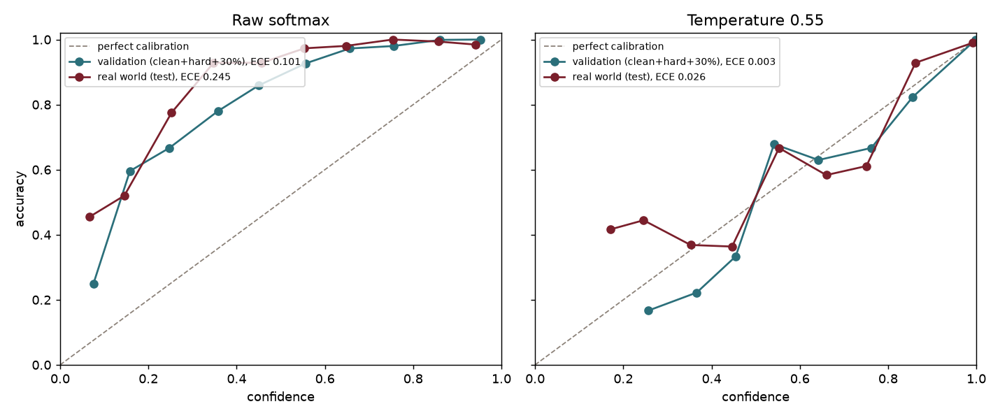
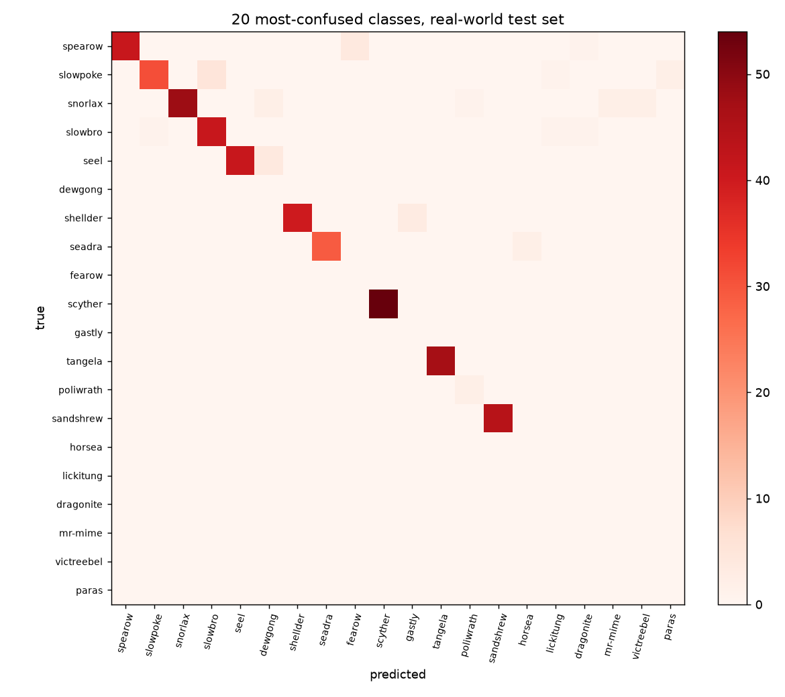

# Model evaluation

Model: **efficientnet_b0** at 224 px, 1025 classes. All numbers come from the ONNX model run through the same code as `POST /api/identify`.

| Test set | Images | v1 top-1 | v1 top-3 | v2 top-1 | v2 top-3 |
|---|---|---|---|---|---|
| Clean: one unseen sprite style per Pokémon | 1025 | 98.6% | 99.3% | **99.8%** | **100.0%** |
| Hard: same images cropped, low-res, blurred, JPEG | 1025 | 95.3% | 98.0% | **99.9%** | **100.0%** |
| **30% visible**: clean images, only 30% of the Pokémon shown | 3075 | 52.0% | 67.7% | **97.6%** | **99.2%** |
| Real world: fan art, cards, toys, photos (Gen 1) | 732 | 77.6% | 84.4% | **90.4%** | **95.0%** |
| Real world, 30% of the subject shown | 732 | 46.7% | 58.2% | **79.1%** | **88.5%** |

**30%-visible target (90% top-1): met** (97.6% on 3075 crops of unseen sprite styles).

v1 was MobileNetV2 trained on clean sprites only. v2 adds animated-sprite frames and more game styles, public-domain real-world images for Gen 1, Pokémon GO / HOME / Scarlet-Violet styles and alternate forms from pokemondb.net, partial-view training (crops keeping 15-90% of the Pokémon), class-balanced sampling and heavy low-quality augmentation.

When v2 says it is sure (above 50%), it is right 95.2% of the time on real-world images and 99.9% on hard ones.

## Calibration

A softmax score is not automatically a probability of being right, so the confidence is calibrated with **temperature scaling**: logits are divided by T = 0.55, fitted by minimising log-loss on the validation sets (clean, hard, 30% visible). The real-world sets are never used for fitting. The API and the browser both read T from `labels.json`. ECE (expected calibration error, 15 bins) is the average gap between confidence and accuracy; lower is better.

| Test set | ECE raw softmax | ECE calibrated |
|---|---|---|
| Clean | 0.093 | **0.002** |
| Hard | 0.087 | **0.004** |
| 30% visible | 0.108 | **0.005** |
| Real world (test) | 0.245 | **0.026** |
| Real world, 30% visible (test) | 0.180 | **0.059** |

## Reported uploads

| File | Expected | v2 prediction | Confidence |
|---|---|---|---|
| user_nidoran_f.png | nidoran-f | nidoran-f ✓ | 76% |

Real-world images exist only for Gen 1 in the public dataset, so later generations are tested on sprites (clean and hard sets) only.

